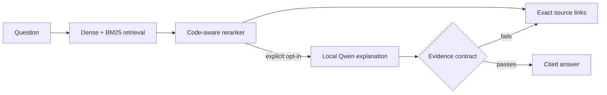

# GitContext — evidence-first answers for public code

[](https://github.com/adity982/GitContext/actions/workflows/ci.yml)

GitContext is a local RAG prototype for answering _why does this code behave this way?_ without hiding the evidence. It indexes a **pinned public revision** of `psf/requests`, recent commits, and merged PR discussions; combines dense retrieval with SQLite FTS5 BM25; reranks the results; and returns immutable GitHub links to the strongest source excerpts.

Retrieval-only evidence is the default. A local Qwen model is available as an explicit experiment, but GitContext withholds generated prose that breaks its citation and answer-shape contract.

## See it work

This output was reproduced against the pinned corpus on November 5, 2026:

```text
> python -m gitcontext.cli ask "Where does Requests strip redirect authorization?"

Indexed psf/requests at 3c7baaa05ab4aa49cc819ce3a819d260de19c157
Answer: The strongest retrieved evidence is
`SessionRedirectMixin.should_strip_auth`, followed by
`SessionRedirectMixin.rebuild_auth`. Inspect both linked excerpts for the exact
behavior. No model explanation was requested. [1] [2]

[1] sessions.py#L154-L184 — SessionRedirectMixin.should_strip_auth
[2] sessions.py#L309-L332 — SessionRedirectMixin.rebuild_auth
```

The actual response includes the two immutable GitHub URLs and the matching source excerpts. On this run, retrieval took **122.1 ms**; model startup was not required.



### What is already measurable

- **21/25 Recall@5** on a fixed source-location benchmark
- **9/25 generated answers** passed the structural evidence contract; the other 16 safely fell back
- **No API key** and no hosted model required
- **Pinned corpus revision** and immutable file, commit, and PR links in every result

This milestone runs entirely on the local machine after downloading the model. It does not support private repositories, permission filtering, automatic updates, incident connectors, or production serving. Generated answers receive only retrieved evidence and their citation numbers are checked, but the small local model can still make unsupported interpretations. Answer correctness has not been independently graded; inspect the linked source before relying on an explanation.

## Setup (Windows PowerShell)

Requires Python 3.12, Git, and GitHub CLI authentication for the PR cache. The embedding model downloads on first indexing run. Local answer generation uses the official Qwen3 1.7B Q8 model (about 1.8 GB) and a pinned Windows CPU build of llama.cpp; `setup_model` downloads and verifies both. No API key is needed.

```powershell
py -3.12 -m venv .venv
.\.venv\Scripts\python.exe -m pip install -r requirements.txt
git clone https://github.com/psf/requests.git data/requests
git -C data/requests checkout 3c7baaa05ab4aa49cc819ce3a819d260de19c157
.\.venv\Scripts\python.exe -m gitcontext.cli fetch-prs --limit 25
.\.venv\Scripts\python.exe -m gitcontext.cli index
.\.venv\Scripts\python.exe -m gitcontext.setup_model
.\.venv\Scripts\python.exe -m gitcontext.cli ask "Where does Requests strip redirect authorization?"
.\.venv\Scripts\python.exe -m gitcontext.cli ask --generate "Where does Requests strip redirect authorization?"
.\.venv\Scripts\python.exe -m gitcontext.cli eval
.\.venv\Scripts\python.exe -m gitcontext.cli eval-answers
.\.venv\Scripts\python.exe -m uvicorn gitcontext.web:app --host 127.0.0.1 --port 8000
```

Open `http://127.0.0.1:8000/`. `/api/ask?q=...` returns the two strongest evidence links without model generation; `/api/search?q=...` returns the wider ranked result set. Add `generate=true` to `/api/ask` or select the experimental checkbox in the web app to opt in to a local-model explanation. The server starts the model lazily on port 18081 and stops it on shutdown. On this laptop's CPU, a generated answer had 49.0-second median latency in the recorded evaluation. If its response breaks the length, paragraph, or citation contract, GitContext withholds the explanation and returns the two highest-ranked source links instead.

## Evidence contract

Each result includes source type, path or PR number, symbol, immutable commit SHA, line range where applicable, author if supplied, and a GitHub link. The index reports the pinned source revision. PR records retain their own merge SHA; a PR match is not automatically treated as proof that the current code still behaves as it did when the PR merged.

The demo uses Python's standard-library AST parser for Python functions, methods, and classes. It chunks Markdown by heading and other text by lines. Large symbols are split into 100-line pieces. Unsupported or unparsable Python files fall back to line chunks. Vector storage uses embedded Qdrant; SQLite stores provenance and the BM25 full-text index.

## Evaluation

`eval/questions.json` contains 25 fixed, manually written questions: 20 code-location and 5 PR-history questions. Each has a source locator as a gold label. `python -m gitcontext.cli eval` writes `eval/report.json` with Recall@5 by category and retrieval latency. The labels test whether a relevant source appears in the top five, **not** whether a generated answer is correct or each claim is supported. Question writers inspected the repository and PR bodies to define source locators; independent human answer grading has not been done.

The recorded local run at commit `3c7baaa05ab4aa49cc819ce3a819d260de19c157` indexed 908 chunks and found the labeled source in the top five for **21/25 questions (84%)**: 16/20 code questions and 5/5 PR-history questions. Median retrieval time was **174.3 ms**, and p95 was **655.1 ms**, measured in one warm, sequential run on this Windows machine. These timings exclude model initialization and indexing. The four missed labels were Q10, Q15, Q17, and Q19; their returned candidates are preserved in the report.

The current ranking is intentionally simple and measurable. To compare components, run with `Index.search(question, rerank=False)` for fused retrieval and compare against the default. The fixed 25-question set is small and partly identifier-rich, so its score is a demo result and must not be generalized to production workloads.

`python -m gitcontext.cli eval-answers` starts the local model once and runs the same fixed questions through the complete answer path. It writes `eval/answer_report.json` with generated-versus-fallback counts, answer latency, whether a gold source reached the two excerpts shown to the model, and every returned answer and citation for inspection. In the recorded 25-question run, 9 answers (36%) passed the structural evidence contract and 16 used the safe fallback; a gold source reached the two-item model context for 20/25 questions (80%). Median answer latency was 49.0 seconds and p95 was 65.1 seconds on this Windows machine. These are objective pipeline signals, not correctness grades; claim-level support still requires human review. That result is why retrieval-only evidence is the default and generation is explicitly opt-in. Use `--limit N` for a shorter smoke run.

## Development checks

```powershell
.\.venv\Scripts\python.exe -m pytest -q
```

Model files, the cloned repository, PR cache, and indices live under ignored `data/`. No API key is required to run the demo.
